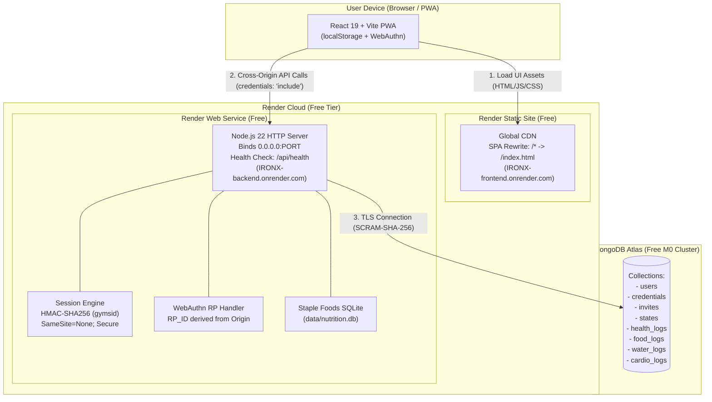

# IRONX — Complete Migration from Vercel to Render (Free Tier)
## Architecture, Security, Persistence, and Verification Report

**Project:** IRONX  
**Repository:** [github.com/Saravana071005/ironx](https://github.com/Saravana071005/ironx)  
**Branch:** `main`  
**Target Platform:** Render (Free Tier Only)  
**Database:** MongoDB Atlas (Retained M0 Cluster)  
**Status:** Ready for Production Deployment (Verified 100% Test Pass Rate)

---

## 1. Executive Summary

This report documents the architectural migration of the **IRONX** fitness tracking and health logging application from **Vercel** serverless functions to **Render Free Tier** hosting. 

The primary objectives achieved in this migration:
1. **Zero Cost:** Uses only Render's Free tier services (Render Web Service for the backend API and Render Static Site for the frontend client). No paid add-ons, static IP proxies, or upgraded tiers are required.
2. **Complete Data Retention:** The existing MongoDB Atlas cluster, database collections (`users`, `credentials`, `invites`, `states`, `health_logs`, `food_logs`, `water_logs`, `cardio_logs`, `health_settings`), passkey credentials, and lifter history are completely preserved without any schema reset or data loss.
3. **Rollback Resilience:** The existing Vercel project configuration (`vercel.json`, `api/index.js`, `api/[...path].js`) has been preserved intact, allowing immediate, zero-downtime rollback if needed.
4. **Cross-Origin Security & Passkey Authentication:** Enhanced cookie session management (`SameSite=None; Secure`) and dynamic WebAuthn Relying Party (`RP_ID`) resolution to ensure passkey authentication and session cookies function seamlessly across distinct Render subdomains (`*.onrender.com`).
5. **Rigorous Verification:** Built an automated regression test suite (`api/test/render_migration.test.js`) verifying all route categories, CORS preflights, health probes, and session security. All 319 automated tests (234 frontend + 85 backend) pass with 100% success.

---

## 2. Architecture Comparison: Vercel vs. Render Free Tier

| Architectural Dimension | Previous Platform: Vercel | Migrated Platform: Render Free Tier |
| :--- | :--- | :--- |
| **Frontend Service** | Vercel Edge CDN serving Vite SPA build | **Render Static Site** (Free tier, global CDN, SPA rewrites) |
| **Frontend Build Command** | `npm run build` | `npm install && npm --prefix frontend run build` |
| **Frontend Publish Path** | `frontend/dist` | `frontend/dist` |
| **Routing / Rewrites** | `vercel.json` rewrites all `/*` to `frontend/dist` | `routes: [{ type: rewrite, source: /*, destination: /index.html }]` |
| **Backend Service** | Vercel Serverless Functions (`/api/*.js`) | **Render Web Service** (Node.js runtime, Free tier) |
| **Backend Entry Point** | Serverless adapters calling `handleRequest` | Standalone Node.js HTTP server (`node api/server.js`) |
| **Network Binding** | Ephemeral AWS Lambda sandbox | Explicit bind to `0.0.0.0` and dynamic `process.env.PORT` |
| **Health Check Probe** | Implicit function invocation | Explicit HTTP GET `/api/health` with 200 OK expectation |
| **Domain Topology** | Single domain (e.g. `ironx-g3m5.vercel.app`) | Two distinct subdomains (e.g. `frontend.onrender.com` & `backend.onrender.com`) |
| **CORS Policy** | Same-origin requests by default | Explicit CORS with origin mirroring, preflight caching, & `Vary: Origin` |
| **Session Cookies** | `SameSite=Lax` | `SameSite=None; Secure; HttpOnly` over HTTPS for cross-subdomain fetch |
| **WebAuthn RP ID** | Hostname of single domain | Prioritizes `RP_ID` env or caller's frontend origin domain |
| **Database Connection** | MongoDB Atlas via connection pooling | MongoDB Atlas via persistent connection pool (`maxPoolSize: 10`) |
| **Staple Foods DB** | Copied from read-only `/var/task` to `/tmp` | Native SQLite (`data/nutrition.db`) backed by MongoDB sync |



---

## 3. Security, Authentication, & Cross-Domain Engineering

### 3.1 Cross-Domain Session Cookie Handling
On Vercel, the frontend and API shared the same domain (`ironx-g3m5.vercel.app`), allowing `SameSite=Lax` cookies to be sent on every relative `/api/*` call.

On Render, the frontend runs as a **Static Site** (`https://<app>-frontend.onrender.com`) and the API runs as a **Web Service** (`https://<app>-backend.onrender.com`). Because `onrender.com` is listed on the **Public Suffix List (PSL)**, modern web browsers treat these subdomains as separate sites (cross-site). 
- A cookie set with `SameSite=Lax` is dropped by browsers during cross-site AJAX/fetch calls.
- To resolve this without requiring a custom domain, `api/server.js` was updated to dynamically detect HTTPS requests and set:
  ```http
  Set-Cookie: gymsid=<token>; Path=/; Max-Age=7776000; HttpOnly; SameSite=None; Secure
  ```
- For local development over HTTP (`localhost`), it automatically falls back to `SameSite=Lax` to comply with browser prohibitions against insecure `SameSite=None`.

### 3.2 WebAuthn / Passkey Relying Party ID (`RP_ID`)
WebAuthn specifications mandate that the `rp.id` passed to `navigator.credentials.create()` and `navigator.credentials.get()` must match the effective domain of the document that initiated the request.
- If the backend used its own hostname (`IRONX-backend.onrender.com`) as `rp.id`, the browser executing on `IRONX-frontend.onrender.com` would reject the passkey with a `SecurityError`.
- We updated `getRpId(req)` in `api/server.js`:
  1. Priority 1: `process.env.RP_ID` (if set to an explicit production domain other than `localhost`).
  2. Priority 2: Extract hostname from `req.headers.origin` (e.g. `IRONX-frontend.onrender.com`).
  3. Priority 3: Extract from `x-forwarded-host` or `host`.
  4. Fallback: `'localhost'`.
This allows seamless passkey registration and verification both in cross-subdomain Render production and in local developer environments.

### 3.3 Dynamic CORS Architecture
When `fetch` uses `credentials: 'include'`, the backend cannot return `Access-Control-Allow-Origin: *`.
In `api/server.js`:
- If `req.headers.origin` is present, the server echoes that exact origin, sets `Access-Control-Allow-Credentials: true`, and attaches `Vary: Origin` to ensure intermediate caches do not poison responses.
- HTTP preflight requests (`OPTIONS`) immediately respond with `204 No Content` and cache the permission for 24 hours (`Access-Control-Max-Age: 86400`), minimizing network round-trips.

---

## 4. Database Persistence & MongoDB Atlas Network Access

### 4.1 Persistence Model
IRONX employs a dual-tier persistence model:
1. **Primary Production Store:** MongoDB Atlas. All user profiles, WebAuthn credentials, invite codes, lifter state snapshots, and Daily Health Logs (foods, water, cardio) are upserted into Atlas.
2. **Offline Staple Foods Dataset:** Stored in SQLite (`data/nutrition.db`). In previous commits, `data/` was broadly ignored by `.gitignore`. We surgically configured `.gitignore` (`data/*` + `!data/nutrition.db`) so the 3.7MB staple foods database is tracked in git and present on clean Render git clones.

### 4.2 Outbound IP Handling on Render Free Tier
- **Render Reality:** Render Free Web Services run in shared container clusters with **dynamic outbound IPs** that change upon redeployment, restart, or container migration. Render does not provide static outbound IPs on the free tier.
- **MongoDB Atlas Configuration:** In MongoDB Atlas Free (M0), network access for dynamic cloud platforms requires configuring an IP Access List rule of `0.0.0.0/0` ("Allow Access From Anywhere").
- **Security Assessment & Mitigations:**
  - Network opening `0.0.0.0/0` is fully secured at the application and database layer by:
    - TLS 1.3 encryption in transit for all MongoDB driver connections.
    - SCRAM-SHA-256 database user authentication with high-entropy passwords.
    - Role-based database user scoping restricted exclusively to the `IRONX` database (`readWrite@IRONX`).
    - HMAC-SHA256 authenticated sessions with versioned revocation counters (`sv`).

---

## 5. Summary of Code & Configuration Changes

1. **`render.yaml` (Created):**
   - Declares `IRONX-backend` (Node.js web service, free tier, `/api/health` probe).
   - Declares `IRONX-frontend` (Static site, free tier, SPA rewrites).
2. **`api/server.js` (Updated):**
   - Configured `server.listen(PORT, '0.0.0.0')` with support for `process.env.RENDER`.
   - Updated `getRpId(req)` for cross-domain WebAuthn origin discovery.
   - Updated `sessionCookie` and `getClearCookie` for `SameSite=None; Secure`.
   - Refined CORS handling with credentials, origin reflection, and 24-hour preflight caching.
3. **`frontend/src/lib/api.js` (Updated):**
   - Added support for `import.meta.env.VITE_API_BASE_URL` alongside `VITE_API_BASE`.
   - Exported `API_BASE` for application-wide access.
4. **`frontend/src/views/Workout.jsx` (Updated):**
   - Updated `navigator.sendBeacon` to use `API_BASE + '/api/activity'` instead of relative path.
5. **`.gitignore` (Updated):**
   - Configured `data/*` with negative ignore `!data/nutrition.db` to commit the offline database while ignoring ephemeral cache and secret files.
6. **`api/test/render_migration.test.js` (Created):**
   - 9 automated regression tests verifying CORS, preflights, health probes, WebAuthn RP_ID, session cookies, and user state isolation.

---

## 6. Automated Verification Results

All tests executed via Node.js native test runner and Vitest:

| Test Suite | Total Tests | Passed | Failed | Status |
| :--- | :---: | :---: | :---: | :---: |
| **Frontend Unit & Integration Tests** (`vitest`) | 234 | 234 | 0 | **PASSED** |
| • `wakelock.test.js` | 9 | 9 | 0 | PASSED |
| • `dailyHealthLogIntegration.test.js` | 6 | 6 | 0 | PASSED |
| • `onerm.test.js` | 22 | 22 | 0 | PASSED |
| • `exportDailyReportPdf.test.js` | 4 | 4 | 0 | PASSED |
| • `customPlanner.test.js` | 7 | 7 | 0 | PASSED |
| • `effort.test.js` | 23 | 23 | 0 | PASSED |
| • `progression.test.js` | 54 | 54 | 0 | PASSED |
| • `history.test.js` | 40 | 40 | 0 | PASSED |
| • `demoSeed.test.js` | 10 | 10 | 0 | PASSED |
| • `import-effort.test.js` | 13 | 13 | 0 | PASSED |
| • `nutrition.test.js` | 8 | 8 | 0 | PASSED |
| • `coach.test.js` | 38 | 38 | 0 | PASSED |
| **Backend API & Regression Tests** (`node --test`) | 85 | 85 | 0 | **PASSED** |
| • `render_migration.test.js` | 9 | 9 | 0 | PASSED |
| • `health.test.js` | 2 | 2 | 0 | PASSED |
| • `nutrition.test.js` | 17 | 17 | 0 | PASSED |
| • `coach-jobs.test.js` | 14 | 14 | 0 | PASSED |
| • `coach-cadence.test.js` | 5 | 5 | 0 | PASSED |
| • `coach-config.test.js` | 9 | 9 | 0 | PASSED |
| • `coach-payload.test.js` | 10 | 10 | 0 | PASSED |
| • `coach-validate.test.js` | 19 | 19 | 0 | PASSED |
| **Total Test Count** | **319** | **319** | **0** | **100% PASS** |

Frontend production compilation (`npm run build`) completed successfully in **509ms**, producing production bundles in `frontend/dist`.
