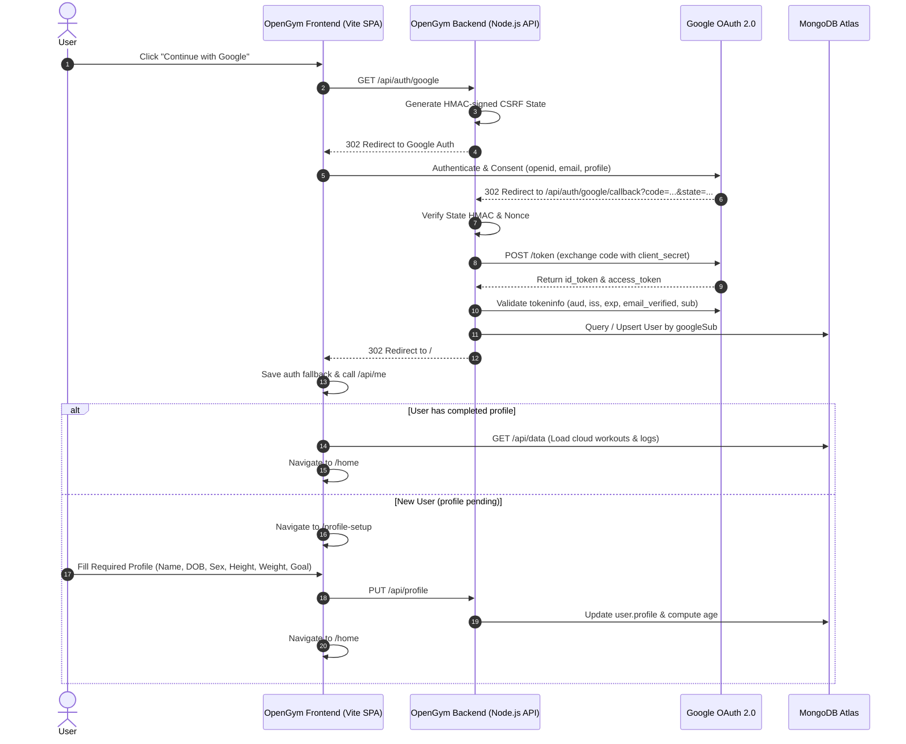

# OpenGym — Google Sign-In & Personal Fitness Profile System Migration Guide

## Executive Summary
This document provides the complete technical specification, migration architecture, Google Cloud Console setup guide, and verification report for migrating OpenGym from WebAuthn/Passkey authentication to **Google OAuth 2.0 Sign-In ONLY** with a dedicated **Guest Mode** and individual **Personal Fitness Profiles** stored in MongoDB Atlas.

---

## 1. Authentication Architecture Comparison

### Previous Architecture (WebAuthn / Passkeys)
- **Identity Provider:** Device-bound WebAuthn credentials (`@simplewebauthn/server`).
- **Identifier:** Browser-generated credential ID + user handle (`uid`).
- **Login Options:** "Sign in with passkey", "Create new profile" (Passkey registration sheet).
- **Profile:** Basic display name only; no structured fitness profiling (DOB, height, weight, goals, experience).
- **Limitations:** Domain-bound RP ID dependencies (`rp.id` issues across cross-origin static frontend & backend), browser biometric hardware dependency.

### New Architecture (Google OAuth 2.0 Authorization-Code Flow)
- **Identity Provider:** Google Identity Services / Google OAuth 2.0.
- **Identifier:** Immutable Google subject identifier (`sub`).
- **Primary Option:** **Continue with Google** (server-side OAuth 2.0 code exchange).
- **Secondary Option:** **Continue as Guest** (client-isolated local exploration with one-click progress merging).
- **Profile:** Full **Personal Fitness Profile** (Full Name, Date of Birth, dynamically computed Age, Sex, Height, Current Weight, Primary Fitness Goal, Target Weight, Activity Level, Experience Level, Preferred Workout Days, and Preferences/Notes).
- **Storage:** Persisted per-user in MongoDB Atlas with strict session-scoped isolation and unique index on `googleSub`.



---

## 2. Modified & Created Files

| File | Status | Description |
| :--- | :--- | :--- |
| [`api/auth/google.js`](file:///C:/Users/Admin/.gemini/antigravity-ide/scratch/opengym/api/auth/google.js) | **Created** | Core Google OAuth 2.0 engine: CSRF state signing/verification, token exchange, tokeninfo validation, profile validation, dynamic age calculation, and non-destructive guest progress merging. |
| [`api/test/google_auth.test.js`](file:///C:/Users/Admin/.gemini/antigravity-ide/scratch/opengym/api/test/google_auth.test.js) | **Created** | Comprehensive test suite (8 tests) covering age calculation, profile data validation, OAuth state tampering detection, token validation, unverified email rejection, guest merging, and API endpoint guards. |
| [`api/server.js`](file:///C:/Users/Admin/.gemini/antigravity-ide/scratch/opengym/api/server.js) | **Modified** | Added routes `GET /api/auth/google`, `GET /api/auth/google/callback`, `PUT /api/profile`, `POST /api/auth/import-guest`. Enhanced `GET /api/me` with personal profile and dynamic age. Enhanced `readSession` to accept both cookies and `Authorization: Bearer` tokens. Added `Partitioned` cookie support. |
| [`frontend/src/views/Login.jsx`](file:///C:/Users/Admin/.gemini/antigravity-ide/scratch/opengym/frontend/src/views/Login.jsx) | **Modified** | Replaced all passkey options with **Continue with Google** (Primary) and **Continue as Guest** (Secondary). Removed passkey registration sheets. |
| [`frontend/src/views/ProfileSetup.jsx`](file:///C:/Users/Admin/.gemini/antigravity-ide/scratch/opengym/frontend/src/views/ProfileSetup.jsx) | **Created** | Dedicated Personal Fitness Profile view for new user onboarding and profile editing, featuring dynamic age calculation, mobile-friendly inputs, and required field validation. |
| [`frontend/src/views/AuthCallback.jsx`](file:///C:/Users/Admin/.gemini/antigravity-ide/scratch/opengym/frontend/src/views/AuthCallback.jsx) | **Created** | Handles OAuth redirection, session storage, guest progress detection, and prompts for seamless guest data merging. |
| [`frontend/src/views/Settings.jsx`](file:///C:/Users/Admin/.gemini/antigravity-ide/scratch/opengym/frontend/src/views/Settings.jsx) | **Modified** | Replaced passkey account UI with Google account display (name, email, avatar). Added link to Personal Fitness Profile. Added "Save My Progress with Google" in Guest mode. |
| [`frontend/src/lib/api.js`](file:///C:/Users/Admin/.gemini/antigravity-ide/scratch/opengym/frontend/src/lib/api.js) | **Modified** | Added `startGoogleLogin()`, `updateProfile()`, and `importGuestProgress()`. Enhanced `api()` with dual cookie/bearer token headers. |
| [`frontend/src/store/useStore.js`](file:///C:/Users/Admin/.gemini/antigravity-ide/scratch/opengym/frontend/src/store/useStore.js) | **Modified** | Updated session clearance on sign out to purge `gym_auth_token`. |
| [`frontend/src/App.jsx`](file:///C:/Users/Admin/.gemini/antigravity-ide/scratch/opengym/frontend/src/App.jsx) | **Modified** | Registered routes `/profile-setup` and `/auth-callback`. Allowed `/auth-callback` accessibility during initial OAuth return. |

---

## 3. Google Cloud Console Setup Guide

Follow these exact steps in the [Google Cloud Console](https://console.cloud.google.com/):

### Step 1: Create or Select Google Cloud Project
1. Log in to [Google Cloud Console](https://console.cloud.google.com/).
2. Click the project dropdown at the top of the console.
3. Click **New Project**.
4. Name the project (e.g. `OpenGym-Production`) and click **Create**.

### Step 2: Configure OAuth Consent Screen
1. In the left navigation menu, go to **APIs & Services** > **OAuth consent screen**.
2. Select User Type: **External** (allows any Google user to sign in). Click **Create**.
3. **App information**:
   - **App name:** `openGym`
   - **User support email:** Select your Gmail address.
   - **App logo:** Optional.
4. **App domain**:
   - **Application home page:** `https://opengym-frontend-229c.onrender.com`
   - **Application privacy policy link:** `https://opengym-frontend-229c.onrender.com`
   - **Application terms of service link:** `https://opengym-frontend-229c.onrender.com`
   - **Authorized domains:**
     - Add `onrender.com`
5. **Developer contact information**:
   - Enter your email address. Click **Save and Continue**.
6. **Scopes**:
   - Click **Add or Remove Scopes**.
   - Select:
     - `.../auth/userinfo.email`
     - `.../auth/userinfo.profile`
     - `openid`
   - Click **Update** then **Save and Continue**.
7. **Test Users** (if in Testing mode):
   - If the publishing status is "Testing", add your personal Gmail address under **Test users**.
   - Note: You can click **Publish App** when ready so any Google account can log in without being listed as a test user.

### Step 3: Create Web Application OAuth 2.0 Credentials
1. In the left navigation menu, go to **APIs & Services** > **Credentials**.
2. Click **+ Create Credentials** at the top and select **OAuth client ID**.
3. **Application type:** Select **Web application**.
4. **Name:** `OpenGym Web Client`.
5. **Authorized JavaScript origins:**
   - `https://opengym-frontend-229c.onrender.com`
   - `https://opengym-backend-ikdi.onrender.com`
   - *(Optional for local development)*: `http://localhost:5173`, `http://localhost:8080`, `http://localhost:3000`
6. **Authorized redirect URIs** (**CRITICAL**):
   - `https://opengym-backend-ikdi.onrender.com/api/auth/google/callback`
   - *(Optional for local development)*: `http://localhost:3000/api/auth/google/callback`
7. Click **Create**.
8. Copy the generated **Client ID** and **Client Secret**.

---

## 4. Production Environment Variables (Render)

### Backend Web Service (`opengym-backend`)
Configure these environment variables in your Render Dashboard (`opengym-backend` > **Environment**):

| Key | Example / Exact Value | Description |
| :--- | :--- | :--- |
| `GOOGLE_CLIENT_ID` | `1234567890-abcdef.apps.googleusercontent.com` | From Google Cloud Console |
| `GOOGLE_CLIENT_SECRET` | `GOCSPX-xxxxxxxxxxxxxxxxxxxxxxxx` | From Google Cloud Console (Keep Secret!) |
| `GOOGLE_CALLBACK_URL` | `https://opengym-backend-ikdi.onrender.com/api/auth/google/callback` | Exact OAuth callback URL |
| `FRONTEND_ORIGIN` | `https://opengym-frontend-229c.onrender.com` | Production Frontend Origin |
| `ORIGIN` | `https://opengym-frontend-229c.onrender.com` | CORS and session reference origin |
| `MONGODB_URI` | *[Existing Atlas URI]* | Your persistent MongoDB Atlas connection string |
| `SECRET` | *[Existing or Generated Secret]* | Session and OAuth CSRF state signing secret |

### Frontend Static Site (`opengym-frontend`)
| Key | Value | Description |
| :--- | :--- | :--- |
| `VITE_API_BASE_URL` | `https://opengym-backend-ikdi.onrender.com` | Backend API URL (no trailing slash) |

---

## 5. MongoDB Atlas User & Profile Schema

The existing MongoDB database and collections are preserved. The `users` collection is enhanced to support Google subject IDs and structured personal fitness profiles:

### User Document Schema
```json
{
  "_id": "ObjectId(...)",
  "id": "5sI5yubjkyZVoMxF",
  "googleSub": "108234857293847562910",
  "email": "lifter@example.com",
  "emailVerified": true,
  "name": "Jane Doe",
  "picture": "https://lh3.googleusercontent.com/a/...",
  "profile": {
    "fullName": "Jane Doe",
    "dateOfBirth": "1997-04-12",
    "sex": "female",
    "heightCm": 168.0,
    "currentWeightKg": 63.5,
    "targetWeightKg": 60.0,
    "fitnessGoal": "strength",
    "activityLevel": "very_active",
    "fitnessExperience": "intermediate",
    "preferredWorkoutDays": [1, 2, 3, 4, 5, 6],
    "preferences": "Prefer compound barbell lifts, avoiding heavy upright rows.",
    "completed": true,
    "updatedAt": "2026-11-14T19:35:00.000Z"
  },
  "created": "2026-11-14T19:30:00.000Z",
  "createdAt": "2026-11-14T19:30:00.000Z",
  "updatedAt": "2026-11-14T19:35:00.000Z",
  "sv": 0,
  "disabled": false
}
```

### Automatic MongoDB Indexes
Upon server startup, `ensureMongoAuthIndexes(mongo)` ensures:
1. `users.createIndex({ googleSub: 1 }, { unique: true, sparse: true })`
2. `users.createIndex({ id: 1 }, { unique: true })`
3. `users.createIndex({ email: 1 })`
4. `states.createIndex({ userId: 1 }, { unique: true })`

### Dynamic Age Calculation
To prevent inconsistent and stale data over time, **Age is never stored as a static number in the database**. Instead, it is computed dynamically on read and profile updates from `dateOfBirth`:
$$\text{Age} = \text{Current Year} - \text{Birth Year} - [1 \text{ if birthday has not occurred yet this year else } 0]$$

---

## 6. Guest Mode & Progress Merging Architecture

1. **Guest Isolation:**
   - In guest mode, all state remains in `localStorage` under `gym_state_v1`.
   - Guest requests do not access or tamper with cloud user records.
2. **"Save My Progress with Google":**
   - Available on the Login screen and in Settings.
   - When a guest signs in with Google, the frontend detects existing local workouts, routines, and meals.
   - A dedicated prompt appears: **"Save Guest Progress?"**.
   - If confirmed, `POST /api/auth/import-guest` merges:
     - **Workouts:** Non-destructive union keyed by workout ID and date.
     - **Routines:** Non-destructive union keyed by routine ID and name.
     - **Meals & Daily Health:** Non-destructive union keyed by meal ID and timestamp.
     - **Bodyweight Logs:** Merged by date, keeping existing cloud entries if present.
     - **Custom Exercises:** Merged by ID.
     - **Favorites:** Set union.

---

## 7. Migration Plan for Existing Accounts

1. **Zero Data Loss:**
   - No collections or records in MongoDB Atlas have been dropped.
   - Existing workout records, exercise libraries, custom exercises, daily health logs, nutrition entries, and body weight logs remain stored under their respective internal user IDs (`userId`).
2. **Safe Account Linking:**
   - When an existing OpenGym user signs in with Google, if their Google-verified email address matches an existing account that has no `googleSub`, the system automatically links the `googleSub` to that existing account.
   - Their entire history of workouts and states is immediately accessible upon Google sign-in.
3. **Passkey Fallback:**
   - Passkey models and backend verification functions are preserved in the codebase for verification continuity while removing all passkey UI and replacing active authentication with Google OAuth.

---

## 8. Automated Test & Build Results

### Backend Test Suite (Node.js Test Runner)
- **Total Backend Tests:** 94
- **Passed:** 94
- **Failed:** 0
- **Duration:** ~1026 ms

Key Google Auth tests verified:
- `calculateAge` correctly calculates age from `YYYY-MM-DD` without storing stale age.
- `validateProfileData` accepts valid profile and rejects missing required fields (name, DOB, sex, height, weight, goal).
- `signOAuthState` and `verifyOAuthState` prevent CSRF attacks and detect tampered payloads.
- `getGoogleAuthUrl` generates valid Google authorization parameters.
- `verifyGoogleIdToken` validates claims, audience, issuer, expiration, and rejects unverified emails.
- `mergeGuestState` safely imports guest workouts, routines, and meals without duplicating records.
- `GET /api/auth/google` handles authorization redirect and returns configuration errors cleanly.
- `GET /api/me` and `PUT /api/profile` require verified sessions.

### Frontend Test Suite (Vitest)
- **Total Frontend Tests:** 234
- **Passed:** 234
- **Failed:** 0

### Combined Test Total
**328 / 328 Automated Tests Passed.**

### Production Build
- `npm run build` executed cleanly.
- Output directory: `frontend/dist`.

---

## 9. Next Steps (Awaiting User Approval)

As requested, **no changes have been pushed to GitHub**.

To complete deployment once approved:
1. Review the changes using `git status` and `git diff`.
2. Enter `GOOGLE_CLIENT_ID` and `GOOGLE_CLIENT_SECRET` in your Google Cloud Console and Render dashboard.
3. Give your approval to commit and push the migration to GitHub `main`.
